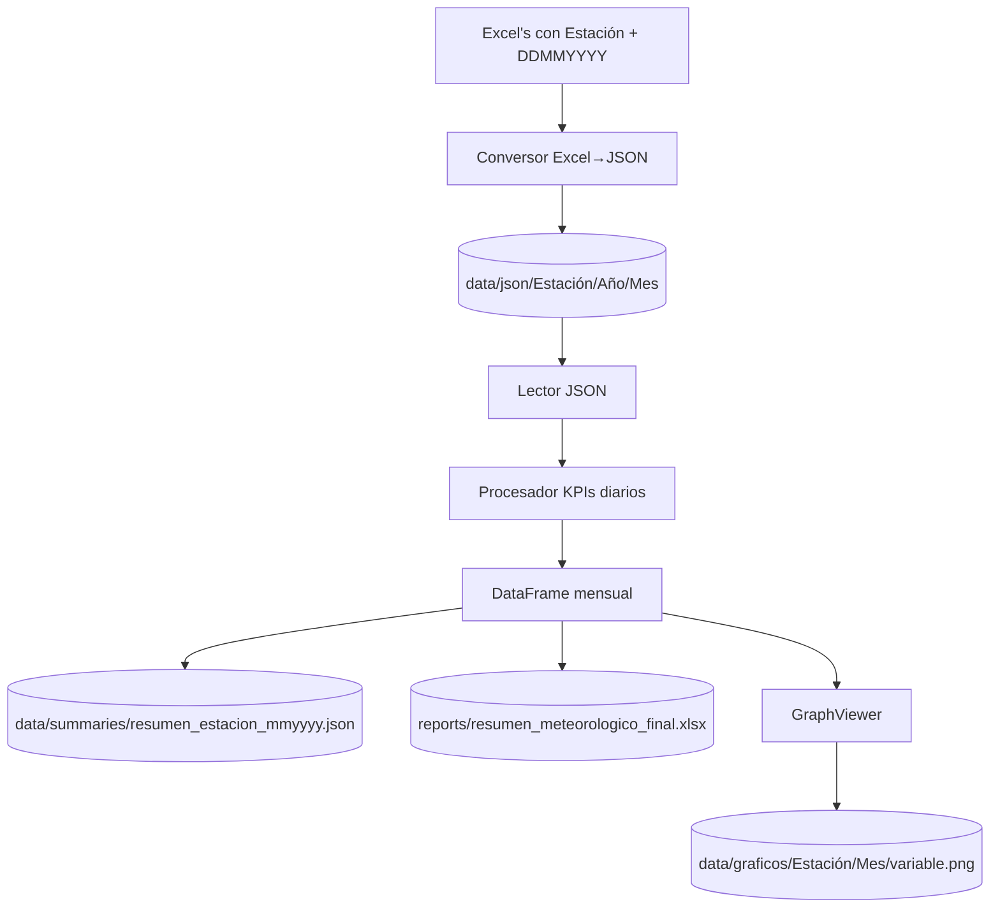

<p align="center">
  
</p>

<p align="center">
  <b>Datos confiables · Cálculos reproducibles · Visualizaciones hermosas</b>
</p>

<p align="center">
  
  
  
  
</p>

### ✨ Visión

Este proyecto realiza estadísticas mensuales de observaciones sinópticas del Instituto Dominicano de Meteorología (INDOMET). Lee Excel, los convierte a JSON con un esquema claro, calcula indicadores diarios/mensuales y ofrece un visor de gráficos dedicado para su análisis visual. Todo con un flujo moderno, desacoplado de Excel y orientado a auditoría.

### 🧭 Estado del proyecto

El proyecto está en desarrollo activo (work-in-progress). Algunas secciones como empaquetado e instalación se habilitarán más adelante.

---

## 🚀 Instalación y ejecución

Requisitos mínimos:

- Python 3.10+
- Dependencias del archivo `requirements.txt`

Pasos:

1. Crear venv (opcional) e instalar dependencias:
   - `pip install -r requirements.txt`
2. Ejecutar la interfaz gráfica:
   - `python main_gui.py`

Notas:
- Los logos opcionales deben estar en `assets/` (`LiL.png`, `LiD.png`).
- Los Excel y JSON se pueden seleccionar desde cualquier ubicación. Por defecto, el proyecto sugiere `data/`.

---

## 🌟 Highlights

- 🔁 Excel → JSON estandarizado (DDMMYYYY, campos horarios y resumen del día)
- 🧮 Cálculo desde JSON (independiente de Excel)
- 🗂️ Organización automática: `Estación/Año/Mes`
- 📈 Visor de gráficos en ventana separada, con historial por Estación/Mes
- 🖼️ Exportación de gráficos en PNG por Estación/Mes
- ✅ Previsualización de archivos y confirmación antes de procesar
- 🧾 Normalización automática de nombres de archivos Excel (asegura `DDMMYYYY`)
- 🗃️ Historial de resúmenes mensual por Estación/Mes y carga directa en visor

---

## 🔀 Flujo de datos (diagrama)



---

## 🧬 Esquema JSON (entrada a cálculos)

```json
{
  "meta": { "estacion": "Estación Central", "fecha": "15052025" },
  "horarias": [
    { "hora": "00Z", "datos": { "p_est": 981.1, "p_nmm": 1014.1, "rocio": 15.1, "t_vapor": 18.1, "hr": 94, "v_dir_deg": 350, "v_vel": 2.2 }},
    { "hora": "03Z", "datos": { "p_est": 980.8, "p_nmm": 1013.5, "rocio": 15.0, "t_vapor": 18.0, "hr": 95, "v_dir_deg": 20,  "v_vel": 2.1 }},
    { "hora": "06Z", "datos": { "p_est": 980.5, "p_nmm": 1012.8, "rocio": 14.8, "t_vapor": 17.8, "hr": 95, "v_dir_deg": 20,  "v_vel": 1.8 }},
    { "hora": "09Z", "datos": { "p_est": 980.6, "p_nmm": 1013.0, "rocio": 14.9, "t_vapor": 17.9, "hr": 92, "v_dir_deg": 30,  "v_vel": 2.5 }},
    { "hora": "12Z", "datos": { "p_est": 981.2, "p_nmm": 1014.5, "rocio": 16.5, "t_vapor": 19.5, "hr": 65, "v_dir_deg": 180, "v_vel": 4.2 }},
    { "hora": "15Z", "datos": { "p_est": 981.5, "p_nmm": 1015.2, "rocio": 17.2, "t_vapor": 20.1, "hr": 60, "v_dir_deg": 170, "v_vel": 4.5 }},
    { "hora": "18Z", "datos": { "p_est": 981.4, "p_nmm": 1015.0, "rocio": 17.0, "t_vapor": 19.8, "hr": 75, "v_dir_deg": 200, "v_vel": 3.8 }},
    { "hora": "21Z", "datos": { "p_est": 981.3, "p_nmm": 1014.8, "rocio": 16.8, "t_vapor": 19.6, "hr": 88, "v_dir_deg": 220, "v_vel": 3.5 }}
  ],
  "resumen_dia": { "pp": 15.5 }
}
```

Notas:
- `meta.fecha` es `DDMMYYYY`.
- Si algún dato no existe en la planilla, se omite (`null`).

---

## 🗃️ Estructura (Resumen mensual)

```text
Resumen mensual/
  main_gui.py
  src/met_analyzer/
    config.py
    data_parser.py
    calc.py
    core.py
    json_pipeline.py
  data/
    json/
    summaries/
    graficos/
  reports/
```

---

## 🏗️ Arquitectura (análisis)

- `data_parser.read_sheets_from_file(path)` · Lee hojas a DataFrames
- `calc.process_day_data(dfs, CONFIG)` · Calcula KPIs diarios (T, presión, HR, viento, nubosidad…)
- `core.run_analysis(paths)` · Orquesta lectura desde Excel
- `json_pipeline.build_json_from_excel(path)` · Crea JSON horario + resumen
- `json_pipeline.run_analysis_from_json(paths)` · Orquesta desde JSON
- `json_pipeline.save_summary_from_dataframe(df)` · Persiste resúmenes mensuales
- `json_pipeline.convert_excels_to_json(paths, out_dir)` · Conversión en lote de Excel a JSON
- `json_pipeline.load_summary_json(path)` · Carga un resumen mensual guardado a DataFrame

---

## 🧩 Configuración (Excel)

Se define en `src/met_analyzer/config.py`.

```python
CONFIG = {
  'hoja_datos_diarios': '3074',
  'hoja_nuvosidad_y_temp': '4074',
  'hoja_resumen_lluvia': '1200Z',
  'celda_lluvia': 'G37',
  'filas_8_observaciones': [11, 14, 17, 20, 23, 26, 29, 32],
  'filas_nuvosidad_dia': [14, 17, 20],
  'filas_nuvosidad_tarde': [23, 26, 29],
  'filas_4_temperaturas': [11, 17, 23, 29],
  'col_presion_estacion': 2, 'col_presion_nmm': 3, 'col_punto_rocio': 9,
  'col_tension_vapor': 10, 'col_humedad_relativa': 11, 'col_viento_direccion': 12,
  'col_viento_velocidad': 13, 'col_nuvosidad': 2, 'col_temp_maxima': 22, 'col_temp_minima': 23,
}
```

---

## 🧰 Manejo de errores comunes

- “grab failed: window not viewable” · resuelto con `transient → lift → wait_visibility → grab_set`.
- Índices fuera de rango (lluvia `G37`) · Se valida; si no existe, `pp = null`.
- Archivos Excel sin fecha en el nombre · Se procesan, pero se recomienda `DDMMYYYY`.

---

## 🗺️ Roadmap (WIP)

- [x] Excel → JSON estandarizado (DDMMYYYY)
- [x] Análisis desde JSON y DataFrame mensual
- [x] Guardado JSON por Estación/Año/Mes
- [x] Visor de gráficos independiente con historial Estación/Mes
- [x] Exportación de gráficos en Estación/Mes
- [x] Previsualización de archivos con confirmación
- [ ] Detección automática de fecha dentro del Excel si no está en el nombre
- [ ] Validación de estación desde metadatos internos
- [ ] Exportación de gráficos en lote con plantillas y estilos

---

## 🔗 Repositorio

Repositorio: https://github.com/ElRed261/Resumen_Mensual_Synop 

---

## 🧭 Ámbito y datos

- Estaciones: todas las estaciones sinópticas del país. A futuro se agregarán estaciones agroclimatológicas, climatológicas y aeronáuticas (según proceso).
- Datos: información interna del INDOMET (Instituto Dominicano de Meteorología). No se incluyen datasets públicos en este repositorio.

---

## 🖥️ Interfaz gráfica: funcionalidades nuevas

- Selección mixta de archivos (`.xlsm/.xlsx` y `.json`) con previsualización, adición/eliminación y confirmación.
- Normalización automática de nombres de Excel con fecha `DDMMYYYY` detectada.
- Conversión a JSON y análisis directo desde JSON, desacoplando cálculos de Excel.
- Visor de gráficos en ventana separada con:
  - Selector de Estación y Mes desde historial (`data/summaries`).
  - Carga de resúmenes previos (`load_summary_json`).
  - Exportación de variables seleccionadas a PNG en `data/graficos/<Estación>/<mmyyyy>/`.

---

## 📂 Estructura de datos generados

```text
data/
  json/
    <Estación>/<YYYY>/<MM>/<Estación> <DDMMYYYY>.json
  summaries/
    resumen_<Estación>_<mmyyyy>.json     # histórico para el visor
  graficos/
    <Estación>/<mmyyyy>/<Variable>.png   # exportaciones desde el visor
reports/
  resumen_meteorologico_final.xlsx        # exportado por el usuario
```

---

## 🤝 Créditos y licencia

- Autoría: Stward Emiliano / Instituto Dominicano de Meteorología (INDOMET)
- Contacto: andryemiliano@gmail.com
- Licencia: sin licencia pública por el momento (todos los derechos reservados hasta definir)

