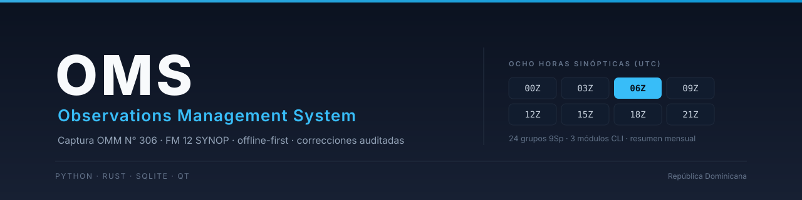
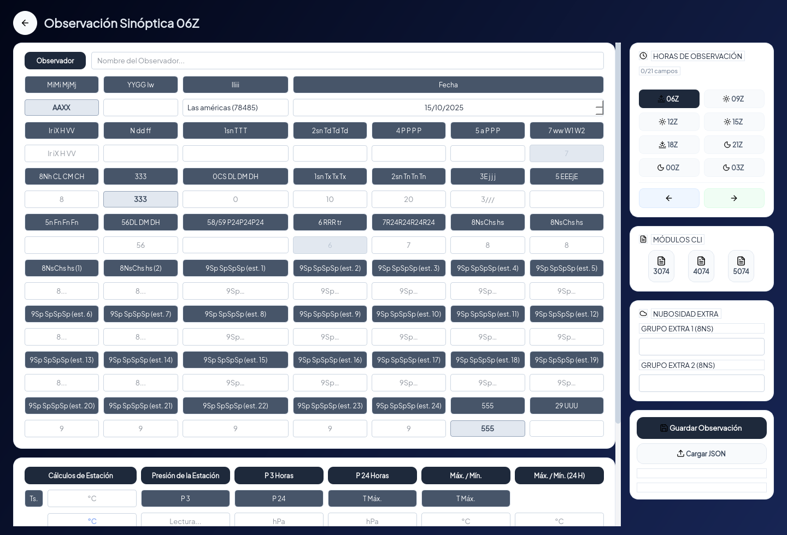
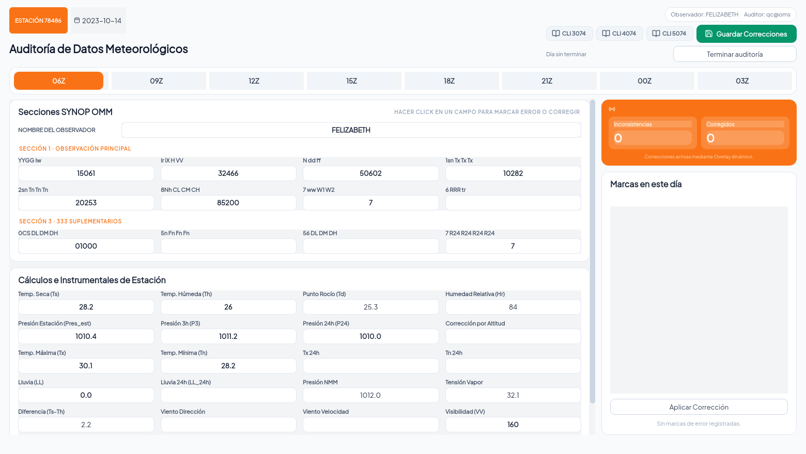

<p align="center">
  
</p>

<p align="center">
  <a href="https://github.com/ElRed261/Proyecto_ARCA/actions/workflows/neoarca.yml"></a>
  
  
  
  
</p>

# OMS — Observations Management System

Sistema de gestión de observaciones meteorológicas de superficie para una red de
estaciones: captura de las ocho horas sinópticas, climatología horaria, resumen
mensual y auditoría con reporte por observador. Construido sobre el **Manual
N° 306 de la OMM (FM 12 SYNOP)**, **offline-first**: cada estación trabaja sin
red y sincroniza con la central cuando puede.

Reemplaza al sistema anterior (React + Tauri) conservando sus datos y su
comportamiento; ese sistema queda como oráculo de verificación.

---

## Capturas

<p align="center">
  
  <br/>
  <sub><b>Observación sinóptica</b> — los 24 grupos 9Sp, grilla agrupada por sección FM 12, progreso por hora y cálculos de estación en vivo.</sub>
</p>

<p align="center">
  
  <br/>
  <sub><b>Auditoría</b> — marcado de error por campo, corrección con justificación, cierre del día y reporte por observador.</sub>
</p>

---

## Módulos

| Módulo | Qué resuelve |
|---|---|
| **Sinóptico** | Observación de las ocho horas sinópticas: 24 grupos 9Sp, cálculos psicrométricos y de presión, coherencia con las tablas de cifrado de la OMM |
| **Climatología (CLI)** | CLI 3074 (horario), 4074 (nubes y fenómenos) y 5074 (extremos, suelo, evaporación), embebidos en la misma ventana |
| **Resumen mensual** | Consolidación del mes, tabla de datos, gráficos y exportación a Excel |
| **Auditoría** | Marcado y corrección de errores por campo, marcado automático de datos obligatorios faltantes, cierre de la revisión y **reporte por observador** con tasas de error, exportable a PDF |
| **Configuración** | Rutas, mantenimiento del archivo, importación de Excel y respaldos |
| **Seguridad** | Roles (administrador, control de calidad, encargado, observador), sesiones de 8 h y administración de estaciones |

---

## Principios de diseño del dato

1. Se guarda **todo lo que el observador digita**; ningún valor calculado se almacena.
2. Cada dato tiene **un solo dueño**: el grupo sinóptico manda y lo demás deriva.
3. El día cierra a las **06Z del día siguiente** (02:00 local); después solo se corrige con justificación auditada.
4. Los documentos JSON del día son la unidad de archivo; la base SQLite es la unidad de trabajo.

---

## Estado

| | |
|---|---|
| **Funcional y en uso interno** | Los seis módulos operan sobre la base real migrada (2.554 documentos JSON del archivo histórico) |
| **En curso** | Validación del módulo de auditoría por el usuario final y empaquetado multiplataforma |
| **Pendiente** | Firma de los instaladores, piloto de 30 días en la red de estaciones y corte definitivo del sistema anterior |

---

## Requisitos

- Python **3.13 o superior** (el desarrollo y el piloto corren sobre 3.14, con la
  variante *free-threaded* `3.14t`)
- Rust estable (para el crate de cálculos)
- Linux, Windows o macOS

---

## Arranque rápido (desarrollo)

El proyecto usa **dos entornos virtuales**: el intérprete *free-threaded* para el
núcleo y los cálculos, y el intérprete con GIL para la interfaz (PySide6 exige
un intérprete con GIL).

```bash
# 1. núcleo y cálculos (venv free-threaded)
python3.14t -m venv .venv
.venv/bin/python -m pip install -e .
(cd oms_calc && ../.venv/bin/python -m maturin develop)

# 2. interfaz (venv con GIL)
python3.14 -m venv .venv-gil
.venv-gil/bin/python -m pip install -e ".[ui]"
(cd oms_calc && ../.venv-gil/bin/python -m maturin build --release -o /tmp/wheels)
.venv-gil/bin/python -m pip install --force-reinstall /tmp/wheels/*.whl

# 3. ejecutar
.venv-gil/bin/python run_dev.py
```

La extensión Rust se compila **una vez por intérprete**: si se reconstruye, hay
que reinstalarla en los dos entornos.

---

## Pruebas

```bash
QT_QPA_PLATFORM=offscreen .venv-gil/bin/python -m pytest -q -m "not slow"   # ciclo diario
QT_QPA_PLATFORM=offscreen .venv-gil/bin/python -m pytest -q                 # suite completa
(cd oms_calc && cargo test)                                                # cálculos en Rust
```

**765 pruebas de Python** (763 en el ciclo rápido; las marcadas `slow` levantan
hilos reales) y **54 de Rust**. Las fórmulas se verifican contra el oráculo del
sistema anterior y contra el Excel de la estación; cada desviación está firmada
en [`docs/CONTRATO_ORACULO.md`](docs/CONTRATO_ORACULO.md).

La integración continua (`.github/workflows/neoarca.yml`) compila la extensión,
corre `cargo clippy -D warnings`, `ruff` y la suite completa con Qt sin pantalla.

---

## Estructura

```
oms_core/        núcleo: base, servicios de dominio, rutas, registro
oms_calc/        crate de Rust (PyO3): fórmulas y tablas de la OMM
oms_ui/          interfaz PySide6: pantallas, tema, iconos
docs/            documentación técnica, marca y capturas
odd/tasks/       especificaciones de cada feature trabajada
tests/           suite de pruebas
packaging/       empaquetado multiplataforma
```

---

## Documentación

| Documento | Contenido |
|---|---|
| [`docs/ARQUITECTURA_DATOS.md`](docs/ARQUITECTURA_DATOS.md) | Modelo del dato, reglas, cierre del día y rutas por sistema operativo |
| [`docs/CONTRATO_ORACULO.md`](docs/CONTRATO_ORACULO.md) | Reglas verificadas contra el sistema anterior y desviaciones firmadas |
| [`docs/CRONOLOGIA.md`](docs/CRONOLOGIA.md) | Historia completa del proyecto, fase por fase |
| [`docs/CHANGELOG.md`](docs/CHANGELOG.md) | Cambios por versión |
| [`Migración/PLAN_MIGRACION_NEoARCA.md`](Migración/PLAN_MIGRACION_NEoARCA.md) | Plan maestro (PRD) |

---

## Licencia

Los términos heredados del proyecto original (CC BY-NC-SA) están en
[`LICENSE`](LICENSE); la estrategia de licenciamiento se define antes del
empaquetado final.
